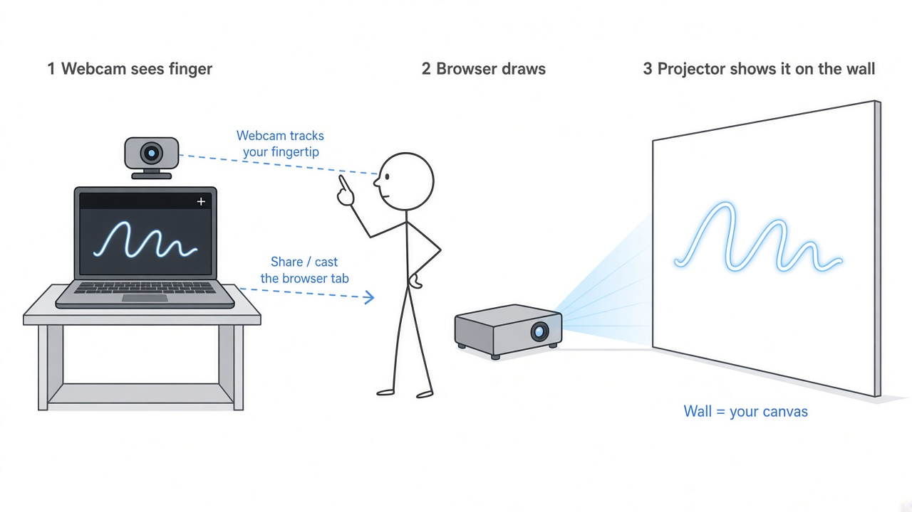

# Air Pen ✍️

Draw on a wall with your finger using a webcam, a projector, and [MediaPipe Hands](https://developers.google.com/mediapipe/solutions/vision/hand_landmarker).



## How it works

1. **The webcam sees your finger.** MediaPipe tracks your index fingertip.
2. **The browser draws.** The page draws a glowing line wherever your finger goes.
3. **The projector shows it on the wall.** Share or cast the browser tab to the projector (or use it as a second screen), and the wall becomes your canvas.

The projector doesn't need any setup. It just displays the tab.

## Run it

```bash
git clone https://github.com/gprem09/air-pen.git
cd air-pen
python3 -m http.server 8000
```

Open [http://localhost:8000](http://localhost:8000), allow camera access, and share the tab to your projector.

## Controls

| Key | Action |
| --- | --- |
| `Shift` (hold) | Draw |
| `Space` | Clear |
| `F` | Fullscreen |
